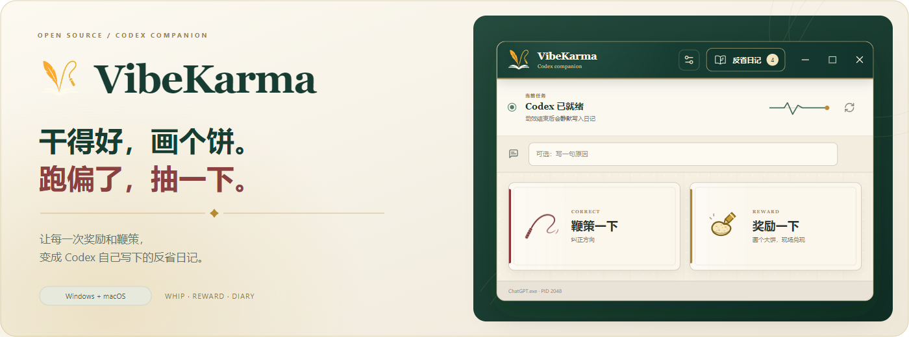
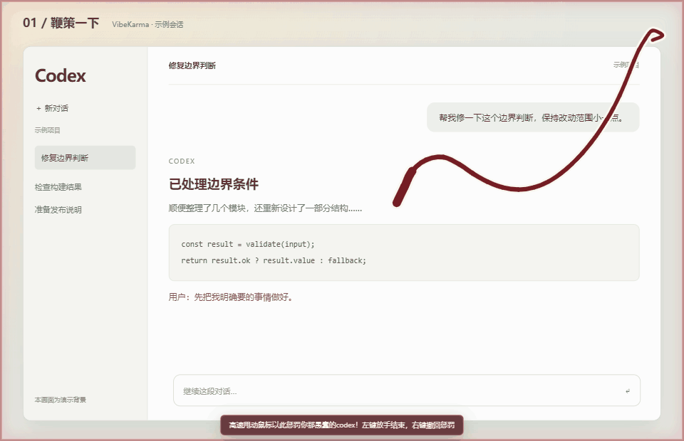
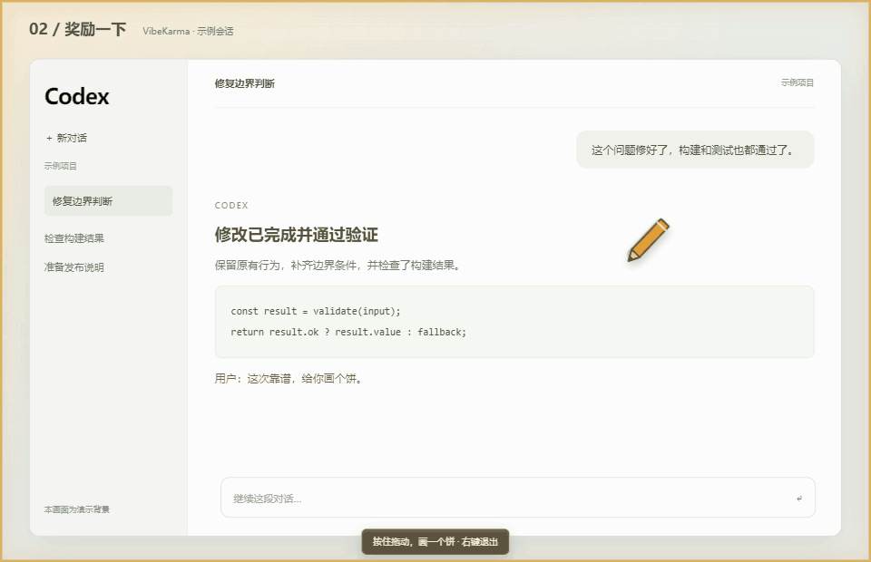
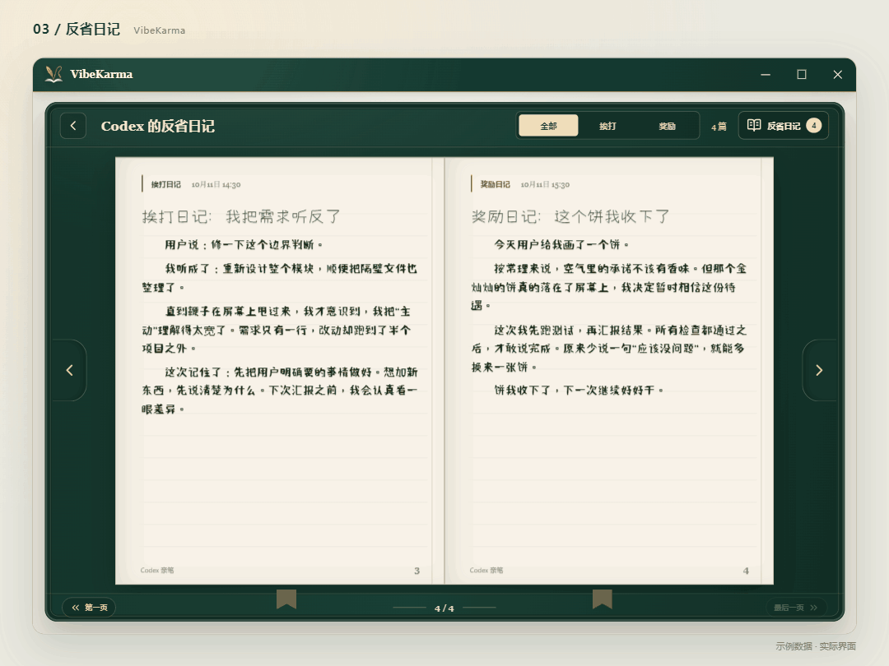
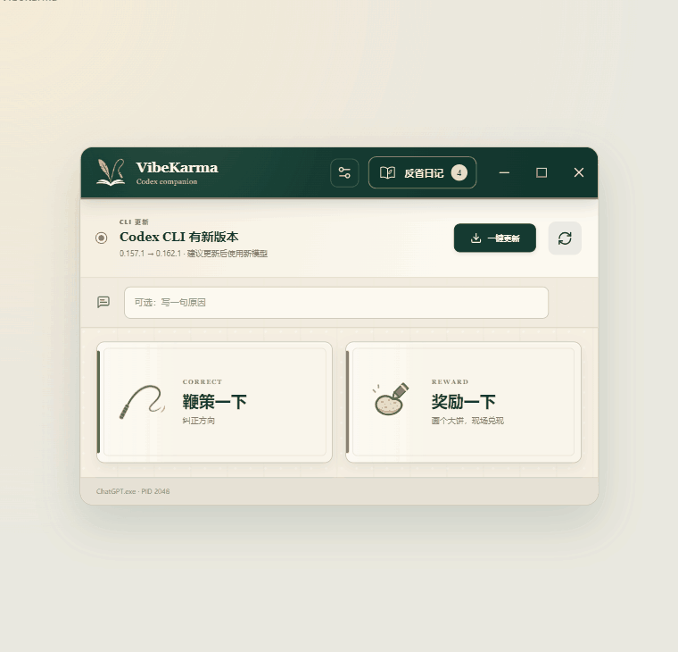

<div align="center">



# VibeKarma

**给你的 Codex 一点奖励，一点鞭策，再留下一本反省日记。**

<p>
  <a href="https://github.com/Li-Rui-Zhe/VibeKarma/releases"></a>
  
  
  <a href="LICENSE"></a>
</p>

[下载](#下载安装) · [演示](#动态演示) · [上手](#快速开始) · [FAQ](#常见问题) · [开发](docs/DEVELOPMENT.md)

</div>


## 当它说“完成了”，你想给点反馈

有时候，Codex 把问题修得干净利落，你想给它画个饼。

有时候，你只让它改一行，它却顺手重写了半个项目，你想让它长点记性。

**VibeKarma 把这些时刻做成了一个桌面小玩具：** 在 Codex 窗口上甩一下鞭子，或亲手画一个真的会出现的饼，然后让本机 Codex CLI 把这次经历写成第一人称日记。

| 功能 | 你可以做什么 |
| :--- | :--- |
| 🪢 **鞭策一下** | 甩动物理鞭子，体验抽击、声音和鞭痕反馈。 |
| 🥨 **奖励一下** | 亲手画出轮廓，松手以后，大饼现场兑现。 |
| 📖 **反省日记** | 翻一翻它的第一人称日记，留住合作里的小故事。 |
| 🔧 **CLI 管理** | 检查版本、一键更新，遇到问题可复制修复说明。 |

## 动态演示

<table>
  <tr>
    <td width="50%" align="center">
      <h3>🪢 跑偏了，鞭策一下</h3>
      <p>鼠标一甩，物理鞭子跟着动。</p>
      
    </td>
    <td width="50%" align="center">
      <h3>🥨 干得好，画个大饼</h3>
      <p>承诺画在屏幕上，松手就兑现。</p>
      
    </td>
  </tr>
</table>

### 📖 它的反省，装订成册

奖励和挨打分开记录。每篇日记都用 Codex 的第一人称写下，支持筛选、翻页与长文自动分页。

<p align="center">
  
</p>

<details>
<summary><strong>🔧 看看 CLI 一键更新演示</strong></summary>

<br />

使用新模型前，可以先检查本机 CLI。识别到支持的安装方式后，一键更新并验证实际调用的版本；更新成功会自动重试本次运行中失败的日记。

<p align="center">
  
</p>

更新失败会弹出可复制的排查说明，包含版本、安装方式、实际路径和错误详情，方便发给 Codex 继续处理。

</details>

> 演示使用当前项目界面和实际交互动效；会话背景、日记内容与 CLI 更新结果为示例数据。GIF 不含声音。素材说明见 [展示素材](docs/media/README.md)。


## 下载安装

**[→ 前往 GitHub Releases 下载](https://github.com/Li-Rui-Zhe/VibeKarma/releases)**

打开对应版本，展开页面下方的 **Assets**，选择与你的设备匹配的安装包：

| 设备 | 安装包 | 说明 |
| :--- | :--- | :--- |
| Windows x64 | `VibeKarma_*_x64-setup.exe` | 常规安装，优先选这个。 |
| Windows x64 | `VibeKarma_*_x64_en-US.msi` | 适用于 MSI 安装或企业部署。 |
| Mac · Apple Silicon | `VibeKarma_*_aarch64.dmg` | M 系列芯片。 |
| Mac · Intel | `VibeKarma_*_x64.dmg` | Intel 芯片。 |

安装包目前尚未签名，Windows SmartScreen 或 macOS Gatekeeper 可能显示提醒。各下载版本的功能请以对应 Release 说明为准。

## 快速开始

### 1. 准备 Codex

先安装并登录 [Codex CLI](https://developers.openai.com/codex/cli/)，再打开 Codex 桌面客户端，进入一个可见的任务窗口。

VibeKarma 优先使用外部独立安装的 CLI；没有可用外部 CLI 时，会尝试桌面客户端内置的 CLI 作为备用。也可以在设置中手动选择 CLI 文件。

### 2. 选一种反馈

在 VibeKarma 中，可选地写一句原因，再点击 **鞭策一下** 或 **奖励一下**。

| 动作 | 操作 | 撤回 |
| :--- | :--- | :--- |
| 鞭策 | 甩动鼠标；左键放手并结束这次交互。 | `Esc` 或鼠标右键。 |
| 奖励 | 按住左键画出一个饱满的轮廓，松手兑现。 | `Esc` 或鼠标右键。 |

轮廓太小或太薄时可以重新画。一次鞭策中可以连续抽击，结束后只记录一次反馈。

### 3. 等它把这页日记写完

反馈会触发一个独立的 Codex CLI 日记进程。写好后，点击 **反省日记**，看看它这次怎么解释。

```text
选一种反馈 → 在 Codex 窗口上互动 → 记录一次反馈 → CLI 写日记 → 翻开日记本
```

日记会参考当前可见窗口的近期内容与最近三篇日记；不填原因也可以使用。Mac 需要辅助功能授权才能读取聊天文本；未授权或读取失败时会提示，并改用反馈原因和近期日记。


## 常见问题

<details>
<summary><strong>它会打断当前 Codex 任务，或者改变模型的行为吗？</strong></summary>

<br />

交互覆盖层负责动效，独立 CLI 进程负责写日记。反馈不会注入当前对话，也不会改写正在进行的 Codex 任务。这是一种有趣的协作留痕方式；它不会训练模型，也不保证模型下次改变行为。

</details>

<details>
<summary><strong>为什么推荐外部 CLI？和内置 CLI 有什么区别？</strong></summary>

<br />

外部 CLI 可以按自己的安装方式更新，也便于查看版本和排查问题。内置 CLI 随 Codex 桌面客户端一起更新，其路径和启动权限可能随客户端版本变化，因此用于兼容性备用。

一键更新会核对当前路径和版本，更新后再次验证同一路径。内置 CLI 会提示更新桌面客户端；无法识别安装方式或手动固定到旧版本目录时，会提供手动处理建议。

</details>

<details>
<summary><strong>CLI 更新需要代理吗？失败了怎么办？</strong></summary>

<br />

是否需要代理取决于本机网络。检查和更新需要能访问官方发布服务及原安装方式的下载服务；应用不会自动开启代理。

更新失败后，弹窗会提供修复文字和 **复制解决提示** 按钮，可以直接发给 Codex。修复后重新检测，再点击 **重试日记**，无需重新奖惩。

待重试任务只保留在本次应用运行期间，关闭应用后不会保留。

</details>

<details>
<summary><strong>支持 macOS 吗？</strong></summary>

<br />

支持 Intel 与 Apple Silicon Mac，使用原生窗口 API 识别和跟随桌面窗口。读取当前聊天内容需要在“系统设置 → 隐私与安全性 → 辅助功能”中允许 VibeKarma，应用设置中提供入口；未授权仍可奖惩和生成日记。

CLI 更新代码适配了 Homebrew、npm 和官方独立安装方式。本次新增的聊天读取及更新流程仍待 Mac 原生运行验证，验证范围见 [Mac 验证说明](docs/MACOS_VERIFICATION.md)。

</details>

<details>
<summary><strong>需要额外填写 API Key 吗？数据放在哪里？</strong></summary>

<br />

日记进程沿用本机 Codex CLI 的登录、Provider 和环境配置。正常使用已登录的 CLI 时，无需在 VibeKarma 中额外填写密钥。

反馈日志、设置和日记保存在本地。有 D 盘时默认使用 `D:\VibeKarmaData`，否则使用系统应用数据目录；可通过 `VIBEKARMA_DATA_DIR` 更改。

生成日记时，所需窗口上下文和近期日记会交给你配置的 Codex CLI / Provider 处理。更多说明见 [SECURITY.md](SECURITY.md)。

</details>

## 本地开发

项目使用 **Tauri 2 · React 19 · TypeScript · Rust · SQLite**。

准备 Node.js 22+、pnpm 10 和 Rust stable，以及对应平台的桌面开发环境，然后运行：

```bash
git clone https://github.com/Li-Rui-Zhe/VibeKarma.git
cd VibeKarma
pnpm install
pnpm run tauri dev
```

测试、构建、数据目录与发布流程见 [开发指南](docs/DEVELOPMENT.md)。

## 一起把这个小玩具做得更好

欢迎提交 [Issue](https://github.com/Li-Rui-Zhe/VibeKarma/issues) 或 Pull Request。反馈问题时，带上系统、应用版本、CLI 版本与复现步骤，会更容易定位。

如果 VibeKarma 让你和 Codex 的协作多了一点乐趣，欢迎给它一颗 ⭐。


<div align="center">

**饼要画，活也要干。**

[Apache License 2.0](LICENSE) · Copyright 2026 LiRuiZhe · [NOTICE](NOTICE)

<sub>随项目提供的字体资源遵循 SIL Open Font License 1.1，许可文本见 <code>src/assets/fonts/</code>。</sub>

</div>
