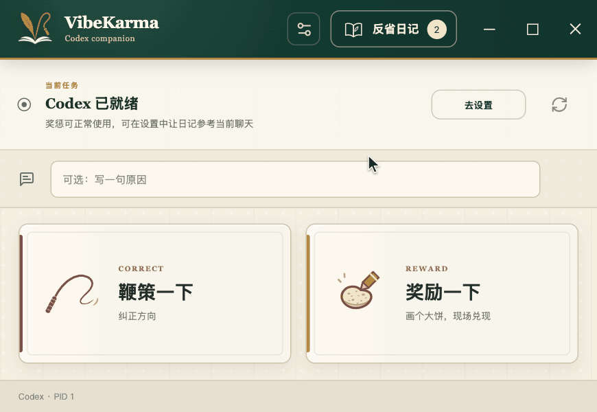

## VibeKarma v0.2.1

这次补丁修复了 Mac 上已经打开辅助功能权限，主页却仍提示「去设置」的问题。读取当前聊天是可选项，跳过授权也能继续奖惩、生成日记。

### 修复内容

- 主页用中性的「去设置」替代「查看原因」。点击后直接定位到「让日记参考当前聊天（可选）」，未授权的说明会用浅红色高亮。
- 从系统设置切回应用时立即复查权限。授权生效后，卡片显示「辅助功能已授权」，主页收起「去设置」。
- 系统授权和本次聊天读取结果分别显示。已授权但当前窗口为空、无法匹配或读取超时时，日记会使用反馈原因和近期日记，主页也不会再次要求授权。
- Mac 使用说明补充了更新后同名旧授权与当前应用签名不匹配时的处理步骤。

### 安装包

| 平台 | 文件 |
| --- | --- |
| Windows x64 · 常规安装 | `VibeKarma_0.2.1_x64-setup.exe` |
| Windows x64 · MSI | `VibeKarma_0.2.1_x64_en-US.msi` |
| Mac · Apple Silicon | `VibeKarma_0.2.1_aarch64.dmg` |
| Mac · Intel | `VibeKarma_0.2.1_x64.dmg` |

Mac 用户请将应用拖入「应用程序」后再启动。若更新后系统开关已开、应用仍提示未授权，可移除旧授权条目，再添加当前安装的 VibeKarma.app。安装包尚未使用开发者证书签名，首次启动的说明见 [Mac 安装指南](https://github.com/Li-Rui-Zhe/VibeKarma/blob/v0.2.1/docs/MACOS.md)。

### 验证范围

Windows、Linux、Mac Intel 与 Apple Silicon 的 CI 均已通过。Windows 和两个 Mac 架构均完成原生应用启动检查及安装包文件名、版本检查。[CI 记录](https://github.com/Li-Rui-Zhe/VibeKarma/actions/runs/45750764889) · [四个安装包的构建记录](https://github.com/Li-Rui-Zhe/VibeKarma/actions/runs/45752527541)

Intel Mac 上已用独立测试包走通「去设置 → 系统授权 → 返回自动刷新」，确认主页入口消失，设置中显示「日记可以参考当前聊天」。其他人工测试场景见 [Mac 验证记录](https://github.com/Li-Rui-Zhe/VibeKarma/blob/v0.2.1/docs/MACOS_VERIFICATION.md)。
